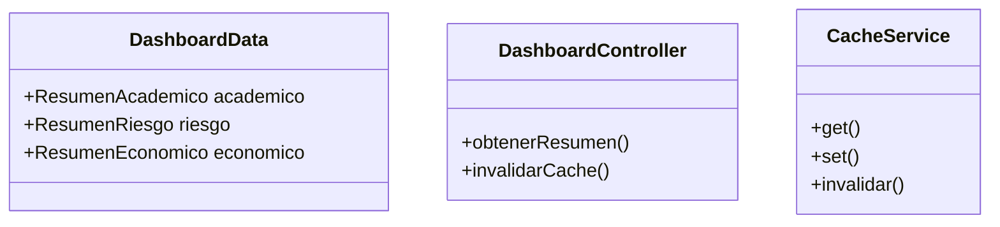
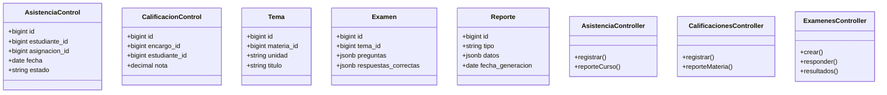
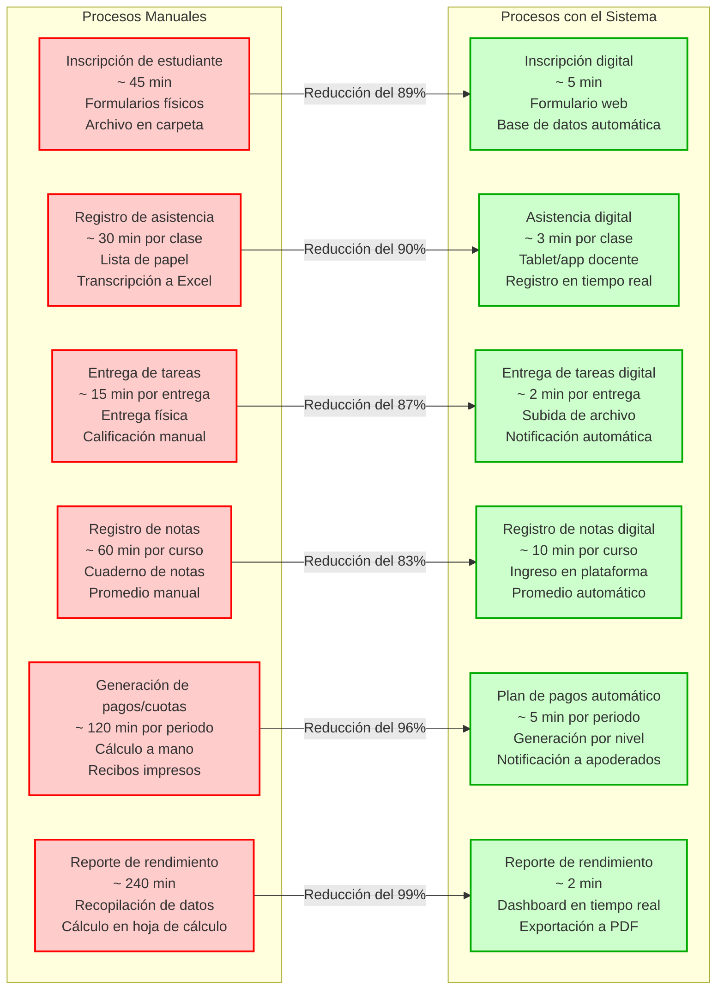

# 🏫 Sistema de Gestión Académica Shalom

Sistema integral de gestión académica desarrollado como proyecto de grado. Está compuesto por una **aplicación móvil (Expo/React Native)**, un **gateway API (ASP.NET Core)**, **9 microservicios backend (Deno + Oak)** y un **servicio de IA/LLM (Python + FastAPI + Ollama)**. Toda la información, flujos y datos se persisten en **PostgreSQL**, con caché y eventos en **Redis**, almacenamiento de archivos en **MinIO** y comunicación en tiempo real mediante **SignalR**.

---

## 📋 Tabla de tecnologías usadas

| Tecnología | Tipo | Versión | ¿Por qué se usa? |
|---|---|---|---|
| React Native | Framework / librería de UI móvil | 0.88.1 | Interfaz nativa de la app móvil (Android/iOS/web) con componentes y navegación. |
| React | Librería de interfaces de usuario | 19.3.0 | Renderizado declarativo de componentes de la app sobre React Native. |
| Expo | Plataforma / framework para React Native | ~58.0.21 | Herramientas de desarrollo, build, módulos nativos (secure-store, imagen, archivos, etc.) y emulador. |
| NativeWind | Librería de estilos | ^4.2.6 | Estilos con sintaxis de Tailwind CSS dentro de React Native. |
| Tailwind CSS | Framework de CSS utilitario | ^3.4.17 | Generación de clases utilitarias de estilo consumidas por NativeWind. |
| TypeScript | Lenguaje de programación (tipado) | ~6.0.3 | Tipado estático del frontend y transpilación a JavaScript para Expo. |
| React Navigation | Librería de navegación | ^7.x | Navegación por pestañas y stack entre pantallas de la app móvil. |
| ASP.NET Core | Framework web backend | net10.0 (.NET 10) | Gateway/API REST que expone los endpoints `/api/*` y hace proxy a los 9 microservicios Deno. |
| C# | Lenguaje de programación | 13 (con .NET 10) | Implementación del gateway, controladores, clientes proxy y Hubs de SignalR. |
| Deno | Entorno de ejecución JS/TS | 2.9.7 | Runtime de los 9 microservicios backend (Usuario, Académico, Inscripción, Tareas, Notificación, Dashboard, Facturación, Gamificación, Control Académico). |
| Oak | Framework web para Deno | ^17.2.0 | Enrutamiento, middlewares y manejo de peticiones HTTP en cada servicio Deno. |
| @db/postgres | Librería de acceso a BD | ^0.19.5 | Conexión y consultas a PostgreSQL desde los servicios Deno. |
| ioredis | Librería de cliente Redis | ^5.4.1 | Cliente de Redis para caché y pub/sub de eventos de notificación. |
| jose | Librería criptográfica JWT | ^5.9.6 | Firma y verificación de tokens JWT (emisión en ServiceUser, validación en los demás). |
| @std/dotenv | Librería de variables de entorno | ^0.225.8 | Carga de archivos `.env` en los servicios Deno. |
| @tajpouria/cors | Middleware CORS para Oak | ^1.2.1 | Control de origen compartido de recursos en las APIs Deno. |
| bcryptjs | Librería criptográfica | ^2.4.3 | Hash de contraseñas de usuarios en ServiceUser. |
| sharp | Librería de procesamiento de imágenes | ^0.34.3 | Redimensionamiento y optimización de fotos de perfil en ServiceUser. |
| minio | Librería de cliente S3 | ^8.0.2 | Subida y descarga de archivos en MinIO (ServiceHomework, ServiceUser). |
| resend | SDK de email | ^4.1.2 | Envío de correos transaccionales (verificación, 2FA, recuperación). |
| @getbrevo/brevo | SDK de email | ^6.0.3 | Proveedor alternativo de envío de correos en ServiceUser. |
| ua-parser-js | Librería de detección de dispositivo | ^2.0.2 | Detección de navegador/dispositivo en login y sesiones. |
| ws | Librería de WebSocket | ^8.16.0 | Cliente WebSocket opcional en ServiceControlAcademic y ServiceGamification. |
| Python | Lenguaje de programación | 3.12 | Servicio de IA/LLM (ServiceAcademicLLMs) con FastAPI. |
| FastAPI | Framework web Python | (sin fijar) | API REST del servicio LLM: ingestión de materiales, webhooks y feedback. |
| Uvicorn | Servidor ASGI Python | (sin fijar) | Servidor que expone la app FastAPI en el puerto 8890. |
| Ollama | Motor de inferencia LLM local | (host, puerto 11434) | Ejecución local de modelos Gemma y Mistral para generación de resúmenes y feedback. |
| fastapi[standard] | Librería Python | última | FastAPI con dependencias estándar (pydantic, starlette, etc.). |
| httpx | Librería HTTP Python | última | Cliente HTTP asíncrono para llamadas entre servicios y a Ollama. |
| ollama | SDK Python de Ollama | última | Cliente oficial para interactuar con Ollama desde Python. |
| redis[hiredis] | Librería Redis Python | última | Cliente de Redis con aceleración C (hiredis) para RAG y notificaciones. |
| pydantic-settings | Librería de configuración Python | última | Gestión de settings y variables de entorno tipadas en el servicio LLM. |
| pymupdf | Librería de procesamiento PDF | última | Extracción de texto de materiales PDF para ingestión RAG. |
| python-docx | Librería de documentos Word | última | Lectura de archivos .docx como material de estudio. |
| openpyxl / xlrd | Librerías de Excel | última | Lectura de archivos de Excel como material de estudio. |
| PostgreSQL | Base de datos relacional | (externo, puerto 5432) | Almacenamiento principal (`ShalomDB` para 8 servicios, `ShalomDBGM` para Gamificación). |
| Redis | Almacenamiento en memoria / caché | 6379 y 6380 | Notificaciones (6379) y almacén vectorial RAG (6380). |
| MinIO | Almacenamiento de objetos compatibles S3 | 9000 | Guardado y entrega pública de archivos de usuarios y materiales (buckets `usuarios`, `materiales`). |
| ClamAV | Antivirus | 3310 (host) | Análisis de archivos subidos antes de aceptarlos en MinIO (503 si no está disponible). |
| SignalR | Comunicación en tiempo real | (ASP.NET Core) | Notificaciones push en tiempo real desde el gateway a los clientes frontend (hand-rolled). |
| Docker | Plataforma de contenedores | — | Empaquetado e isolamiento de los 11 servicios del sistema. |
| Docker Compose | Orquestación de contenedores | — | Despliegue y red de los 11 servicios con un solo comando (`docker compose -p shalom_backend`). |
| Git | Control de versiones | — | Historial y gestión del código fuente del repositorio. |
| SQL | Lenguaje de consultas | — | Definición del esquema (`BDmain.sql`, `BDgm.sql`) y semillas (`datos.sql`). |

> **Nota:** PostgreSQL, Redis, MinIO, ClamAV y Ollama son **infraestructura externa** (no hay contenedores de ellos en el compose). Se asumen ya desplegados en el host.

---

## 🏗️ Arquitectura del sistema

El sistema sigue una arquitectura de **microservicios** desacoplados mediante un **gateway API**:

```
┌─────────────────────────────────────────────────────────────────┐
│                     CLIENTE (Frontend Expo)                      │
│              React Native + TypeScript + NativeWind              │
│                  (puerto 8081 / Expo bundler)                    │
└─────────────────────────────────────────────────────────────────┘
                              │
                              │ REST /api/*  +  WS SignalR
                              ▼
┌─────────────────────────────────────────────────────────────────┐
│                     GATEWAY (RestApi)                            │
│                  ASP.NET Core .NET 10 (puerto 5141)               │
│             Proxy → 9 servicios Deno  +  SignalR Hub             │
└─────────────────────────────────────────────────────────────────┘
                              │
      ┌───────────┬───────────┼───────────┬───────────┬───────────┐
      ▼           ▼           ▼           ▼           ▼           ▼
┌───────┐   ┌─────────┐  ┌─────────┐  ┌──────────┐  ┌─────────┐
│User   │   │Academic │  │Enrollment│ │ Homework │  │Notific. │
│ 8880  │   │  8881   │  │  8882   │  │  8883    │  │  8884   │
└───────┘   └─────────┘  └─────────┘  └──────────┘  └─────────┘
      │           │           │           │           │
      ▼           ▼           ▼           ▼           ▼
┌───────┐   ┌─────────┐  ┌─────────┐  ┌──────────┐  ┌─────────┐
│Billing│   │Dashboard│  │Gamif.   │  │ControlAc.│  │         │
│ 8886  │   │  8885   │  │  8887   │  │  8888    │  │         │
└───────┘   └─────────┘  └─────────┘  └──────────┘  └─────────┘
      │           │           │           │
      ▼           ▼           ▼           ▼
┌─────────────────────────────────────────────────────────────────┐
│                  SERVICIO LLM (ServiceAcademicLLMs)               │
│                 Python + FastAPI + Ollama (puerto 8890)           │
└─────────────────────────────────────────────────────────────────┘
                              │
              ┌───────────────┼───────────────┐
              ▼               ▼               ▼
         PostgreSQL       Redis (6379/6380)   MinIO (9000)
         ShalomDB /       Caché + RAG +        Almacenamiento
         ShalomDBGM       Eventos              de objetos
```

---

## 🗄️ Diagrama de base de datos

El esquema principal está en `Esquems/BDmain.sql` (base `ShalomDB`) y el de gamificación en `Esquems/BDgm.sql` (base `ShalomDBGM`).

### Diagrama relacional (Mermaid)

```mermaid
erDiagram
    roles ||--o{ usuarios : "tiene"
    usuarios ||--|| usuario_cuenta : "tiene"
    usuarios ||--|| usuario_documentos : "tiene"
    usuarios ||--|| usuario_direcciones : "tiene"
    usuarios ||--o{ usuario_contactos : "tiene"
    usuarios ||--|| estudiantes : "es"
    usuarios ||--|| apoderados : "es"
    usuarios ||--|| maestros : "es"
    estudiantes ||--o{ estudiante_apoderado : "tiene"
    apoderados ||--o{ estudiante_apoderado : "tiene"
    maestros ||--o{ maestro_materias : "imparte"
    materias ||--o{ maestro_materias : "imparte en"
    periodos_academicos ||--o{ trimestres : "contiene"
    periodos_academicos ||--o{ cursos_periodo : "genera"
    periodos_academicos ||--o{ planes_pago : "tiene"
    periodos_academicos ||--o{ mallas_curriculares : "define"
    periodos_academicos ||--o{ solicitudes_inscripcion : "referencia"
    periodos_academicos ||--o{ pensiones : "genera"
    cursos ||--o{ cursos_periodo : "instan"
    turnos ||--o{ cursos_periodo : "asigna"
    turnos ||--o{ horarios : "define"
    cursos_periodo ||--o{ horarios : "tiene"
    cursos_periodo ||--o{ asignaciones_docentes : "tiene"
    cursos_periodo ||--o{ inscripciones : "recibe"
    cursos_periodo ||--o{ curso_asesor : "tiene asesor"
    materias ||--o{ grado_materias : "pertenece al grado"
    materias ||--o{ malla_temas : "tiene temas"
    materias ||--o{ mallas_curriculares : "está en malla"
    materias ||--o{ asignaciones_docentes : "se asignan"
    asignaciones_docentes ||--o{ horarios : "genera"
    asignaciones_docentes ||--o{ materia_materiales : "tiene materiales"
    asignaciones_docentes ||--o{ encargos : "publica"
    asignaciones_docentes ||--o{ asistencia : "registra"
    maestro_materias ||--|| maestros : "de"
    maestro_materias ||--|| materias : "de"
    encargos ||--o{ encargo_materiales : "relaciona"
    materia_materiales ||--o{ encargo_materiales : "relaciona"
    encargos ||--o{ encargo_entregas : "recibe"
    encargos ||--o{ calificaciones : "tiene"
    estudiantes ||--o{ encargo_entregas : "entrega"
    estudiantes ||--o{ calificaciones : "recibe"
    estudiantes ||--o{ asistencia : "registra"
    estudiantes ||--o{ inscripciones : "tiene"
    estudiantes ||--o{ solicitudes_inscripcion : "solicita"
    estudiantes ||--o{ pensiones : "tiene"
    estudiantes ||--o{ pagos : "realiza"
    apoderados ||--o{ pagos : "realiza (indirecto)"
    planes_pago ||--o{ cuotas_plan_pago : "desglosa"
    planes_pago ||--o{ pensiones : "aplica"
    cuotas_plan_pago ||--o{ pago_pensiones : "se paga con"
    pensiones ||--o{ pago_pensiones : "se paga con"
    pagos ||--o{ pago_pensiones : "cubre"
    malla_temas ||--|| materias : "de"
    nivel_curso : nivel
```

### Resumen de módulos de base de datos

| Módulo | Tablas principales | Servicio responsable |
|---|---|---|
| Usuarios y autenticación | `roles`, `usuarios`, `usuario_cuenta`, `usuario_documentos`, `usuario_direcciones`, `usuario_contactos` | ServiceUser |
| Estudiantes y apoderados | `estudiantes`, `apoderados`, `estudiante_apoderado` | ServiceUser / ServiceEnrollment |
| Docentes | `maestros`, `maestro_materias` | ServiceUser / ServiceAcademic |
| Académico | `periodos_academicos`, `trimestres`, `turnos`, `aulas`, `materias`, `cursos`, `grado_materias`, `malla_temas`, `cursos_periodo`, `mallas_curriculares`, `asignaciones_docentes`, `horarios`, `curso_asesor` | ServiceAcademic |
| Inscripción | `solicitudes_inscripcion`, `inscripciones` | ServiceEnrollment |
| Materiales y tareas | `materia_materiales`, `encargos`, `encargo_materiales`, `encargo_entregas` | ServiceHomework |
| Calificaciones y asistencia | `calificaciones`, `asistencia` | ServiceHomework / ServiceControlAcademic |
| Pagos y economía | `planes_pago`, `cuotas_plan_pago`, `pensiones`, `pagos`, `pago_pensiones` | ServiceBilling |
| Gamificación (ShalomDBGM) | `estudiantes_gamificacion`, `rachas_diarias`, `puntos_individuales`, `puntos_globales`, `insignias`, `insignias_estudiante`, `trofeos`, `trofeos_estudiante`, `tienda_recompensas`, `compras_estudiante`, `actividades_gamificadas` | ServiceGamification |

---

## 📦 Diagrama de clases por módulos

### Módulo: Autenticación y Usuarios (ServiceUser)

```mermaid
classDiagram
    class Usuario {
        +bigint id
        +bigint rol_id
        +string nombre
        +string apellido_paterno
        +string apellido_materno
        +date nacimiento
        +string genero
        +string foto_url
        +string estado
        +datetime fecha_creacion
        +datetime fecha_actualizacion
    }
    class UsuarioCuenta {
        +bigint id
        +bigint usuario_id
        +string username
        +string email
        +string password_hash
        +bool email_verificado
        +bool primer_login
        +int intentos_fallidos
        +datetime ultimo_login
    }
    class Rol {
        +bigint id
        +string rol
        +string descripcion
        +bool activo
    }
    class AuthController {
        +login()
        +verify2FA()
        +resend2FA()
        +changePassword()
        +logout()
    }
    class UsuarioController {
        +create()
        +update()
        +delete()
        +baja()
        +views()
    }
    class SessionService {
        +crearSesion()
        +validarSesion()
        +cerrarSesion()
    }
    class TwoFactorService {
        +generarCodigo()
        +verificarCodigo()
    }
    class WebSocketService {
        +manejarConexion()
    }
    Usuario ||--|| UsuarioCuenta : "tiene"
    Usuario }o-- Rol : "pertenece a"
    AuthController ..> SessionService : usa
    AuthController ..> TwoFactorService : usa
    UsuarioController ..> SessionService : usa
```

### Módulo: Académico (ServiceAcademic)

```mermaid
classDiagram
    class PeriodoAcademico {
        +bigint id
        +int anio
        +string nombre
        +date fecha_inicio
        +date fecha_fin
        +string estado
        +bool activo
    }
    class Trimestre {
        +bigint id
        +bigint periodo_id
        +int numero
        +date inicio
        +date fin
    }
    class Materia {
        +bigint id
        +string codigo
        +string nombre
        +string tipo_materia
        +int carga_horaria_semanal
    }
    class Curso {
        +bigint id
        +string nivel
        +string grado
        +string paralelo
        +int capacidad_maxima
    }
    class CursoPeriodo {
        +bigint id
        +bigint curso_id
        +bigint periodo_id
        +bigint turno_id
        +string estado
    }
    class Horario {
        +bigint id
        +bigint curso_periodo_id
        +bigint materia_id
        +bigint maestro_id
        +bigint aula_id
        +int dia_semana
        +time hora_inicio
        +time hora_fin
    }
    class AsignacionDocente {
        +bigint id
        +bigint maestro_id
        +bigint materia_id
        +bigint curso_periodo_id
        +string estado
    }
    class MallaTema {
        +bigint id
        +string nivel
        +string grado
        +bigint materia_id
        +int unidad
        +string titulo
    }
    class PeriodoController {
        +crear()
        +activar()
        +generarHorarios()
        +generarPlanPagos()
    }
    class MateriaController {
        +crud()
    }
    class HorarioController {
        +generar()
        +manual()
    }
    class SeguimientoService {
        +libroNotas()
        +panelCurso()
        +panelEstudiante()
        +riesgo()
    }
    PeriodoAcademico ||--o{ Trimestre : "tiene"
    PeriodoAcademico ||--o{ CursoPeriodo : "genera"
    PeriodoAcademico ||--o{ MallaCurricular : "define"
    Curso ||--o{ CursoPeriodo : "instancia"
    CursoPeriodo ||--o{ Horario : "tiene"
    CursoPeriodo ||--o{ AsignacionDocente : "tiene"
    Materia ||--o{ Horario : "se dicta en"
    Materia ||--o{ MallaTema : "tiene temas"
    Materia ||--o{ AsignacionDocente : "se asigna"
    Maestro ||--o{ AsignacionDocente : "imparte"
    PeriodoController ..> SeguimientoService : usa
```

### Módulo: Inscripción (ServiceEnrollment)

```mermaid
classDiagram
    class Inscripcion {
        +bigint id
        +bigint estudiante_id
        +bigint curso_periodo_id
        +bigint periodo_id
        +string origen
        +string estado
    }
    class SolicitudInscripcion {
        +bigint id
        +bigint estudiante_id
        +bigint periodo_id
        +bigint curso_periodo_destino_id
        +string tipo
        +string estado
    }
    class CursoPeriodoController {
        +listar()
        +crear()
        +eliminar()
    }
    class InscripcionController {
        +solicitar()
        +habilitar()
        +aprobar()
        +rechazar()
        +retirar()
    }
    class AsesorController {
        +asignar()
        +listar()
    }
    class InscripcionService {
        +procesarSolicitud()
        +validarCupo()
    }
    Inscripcion }o-- Estudiante : "de"
    Inscripcion }o-- CursoPeriodo : "en"
    SolicitudInscripcion }o-- Estudiante : "de"
    SolicitudInscripcion }o-- CursoPeriodo : "destino"
```

### Módulo: Tareas y Materiales (ServiceHomework)

```mermaid
classDiagram
    class Material {
        +bigint id
        +bigint asignacion_id
        +bigint tema_id
        +string tipo_material
        +string titulo
        +string archivo_url
        +int tamanio_bytes
    }
    class Encargo {
        +bigint id
        +bigint asignacion_id
        +string tipo
        +string titulo
        +decimal ponderacion
        +date fecha_limite
        +string estado
    }
    class Entrega {
        +bigint id
        +bigint encargo_id
        +bigint estudiante_id
        +string archivo_url
        +string estado_entrega
    }
    class Calificacion {
        +bigint id
        +bigint encargo_id
        +bigint estudiante_id
        +decimal nota
    }
    class Asistencia {
        +bigint id
        +bigint estudiante_id
        +bigint asignacion_id
        +date fecha
        +string estado
    }
    class MaterialController {
        +subir()
        +descargar()
        +eliminar()
    }
    class EncargoController {
        +crear()
        +publicar()
        +cerrar()
    }
    class AprendizajeController {
        +generarResumen()
        +crearReto()
        +completarReto()
        +consultarFeedback()
    }
    Material }o-- AsignacionDocente : "de"
    Encargo }o-- AsignacionDocente : "de"
    Encargo ||--o{ Entrega : "recibe"
    Encargo ||--o{ Calificacion : "tiene"
    Entrega }o-- Estudiante : "de"
    Calificacion }o-- Estudiante : "de"
    Asistencia }o-- Estudiante : "de"
    Asistencia }o-- AsignacionDocente : "de"
```

### Módulo: Notificaciones (ServiceNotification)

```mermaid
classDiagram
    class Notificacion {
        +bigint id
        +bigint usuario_id
        +string tipo
        +string titulo
        +string mensaje
        +bool leída
        +datetime fecha_creacion
    }
    class ReglaEvento {
        +string evento
        +string audiencia
        +string accion
    }
    class NotificacionController {
        +listar()
        +marcarLeída()
        +eliminar()
        +emitir()
    }
    class EventBusService {
        +publicar()
        +suscribirse()
    }
    class ReglasService {
        +resolverAudiencia()
    }
    Notificacion }o-- Usuario : "destinatario"
    ReglaEvento ..> Notificacion : "genera"
```

### Módulo: Dashboard (ServiceDashboard)



### Módulo: Facturación (ServiceBilling)

```mermaid
classDiagram
    class PlanPago {
        +bigint id
        +bigint periodo_id
        +string nivel
        +string nombre
        +int cantidad_cuotas
        +decimal monto_total
        +decimal monto_cuota
    }
    class CuotaPlanPago {
        +bigint id
        +bigint plan_id
        +int numero
        +date fecha_vencimiento
        +decimal monto
        +string estado
    }
    class Pension {
        +bigint id
        +bigint estudiante_id
        +bigint periodo_id
        +string concepto
        +decimal monto
        +string estado
    }
    class Pago {
        +bigint id
        +bigint estudiante_id
        +decimal monto
        +string metodo
        +datetime fecha_pago
    }
    class DeudaService {
        +calcularDeuda()
        +listarDeudas()
    }
    PlanPago ||--o{ CuotaPlanPago : "desglosa"
    PlanPago ||--o{ Pension : "aplica"
    Pension }o-- Estudiante : "de"
    Pago ||--o{ PagoPension : "cubre"
    Pension ||--o{ PagoPension : "se paga con"
```

### Módulo: Gamificación (ServiceGamification)

```mermaid
classDiagram
    class EstudianteGamificacion {
        +bigint id
        +bigint usuario_id
        +bigint estudiante_id
        +string tag
        +string curso_periodo_id
        +string paralelo
        +string avatar_url
    }
    class RachaDiaria {
        +bigint id
        +bigint usuario_id
        +date fecha
        +bool completada
        +int aciertos
        +int racha_actual
    }
    class PuntoIndividual {
        +bigint id
        +bigint usuario_id
        +string tipo
        +int puntos
        +jsonb metadata
    }
    class Insignia {
        +bigint id
        +string codigo
        +string nombre
        +jsonb criterio
    }
    class Trofeo {
        +bigint id
        +string codigo
        +string nombre
        +int puntos
        +string periodo
    }
    class TiendaRecompensa {
        +bigint id
        +string nombre
        +int costo_puntos
        +string tipo
    }
    class CompraEstudiante {
        +bigint id
        +bigint usuario_id
        +bigint recompensa_id
        +int puntos_gastados
    }
    class ActividadGamificada {
        +bigint id
        +bigint usuario_id
        +string tipo
        +int aciertos
        +int total
        +int puntos_ganados
    }
    EstudianteGamificacion ||--o{ RachaDiaria : "tiene"
    EstudianteGamificacion ||--o{ PuntoIndividual : "gana"
    EstudianteGamificacion ||--o{ InsigniaEstudiante : "obtiene"
    EstudianteGamificacion ||--o{ TrofeoEstudiante : "obtiene"
    EstudianteGamificacion ||--o{ CompraEstudiante : "realiza"
    Insignia ||--o{ InsigniaEstudiante : "otorgada"
    Trofeo ||--o{ TrofeoEstudiante : "otorgado"
    TiendaRecompensa ||--o{ CompraEstudiante : "comprada"
```

### Módulo: Control Académico (ServiceControlAcademic)



---

## ⚖️ Diagrama de comparación de procesos: Manual vs Con el sistema

El siguiente diagrama compara el tiempo y los pasos de los procesos académicos y administrativos realizados de forma **manual** frente a los mismos procesos ejecutados con el **sistema Shalom**.



### Cuadro comparativo de tiempos estimados

| Proceso | Tiempo manual | Tiempo con el sistema | Reducción estimada |
|---|---|---|---|
| Inscripción de estudiante | ~45 min | ~5 min | ~89% |
| Registro de asistencia (por clase) | ~30 min | ~3 min | ~90% |
| Entrega de tarea (por alumno) | ~15 min | ~2 min | ~87% |
| Registro de notas (por curso) | ~60 min | ~10 min | ~83% |
| Generación de plan de pagos (por periodo) | ~120 min | ~5 min | ~96% |
| Reporte de rendimiento institucional | ~240 min | ~2 min | ~99% |

---

## 🚀 Puertos y servicios

| Servicio | Puerto | Descripción |
|---|---|---|
| ServiceUser | 8880 | Usuarios, autenticación, 2FA, WebSocket, sesiones |
| ServiceAcademic | 8881 | Periodos, materias, horarios, malla, seguimiento |
| ServiceEnrollment | 8882 | Inscripciones, cursos-periodo, asesores, asignaciones |
| ServiceHomework | 8883 | Materiales, encargos, entregas, calificaciones, asistencia, LLM |
| ServiceNotification | 8884 | Notificaciones, bus de eventos, reglas de difusión |
| ServiceDashboard | 8885 | Tablero de mando, KPIs, riesgo, económico (solo lectura) |
| ServiceBilling | 8886 | Planes de pago, cuotas, pagos, deuda, economía |
| ServiceGamification | 8887 | Racha diaria, puntos, insignias, trofeos, tienda, ranking |
| ServiceControlAcademic | 8888 | Control docente: asistencia, calificaciones, temas, exámenes, reportes |
| RestApi (Gateway) | 5141 / 7064 | API REST y SignalR, proxy a los microservicios |
| ServiceAcademicLLMs | 8890 | IA/LLM: resúmenes, explicaciones, retos, feedback (FastAPI + Ollama) |
| MinIO API | 9000 | Almacenamiento de archivos (usuarios, materiales) |
| MinIO Consola | 9001 | Consola de administración de MinIO |
| Redis Notificaciones | 6379 | Caché y pub/sub de eventos |
| Redis RAG | 6380 | Almacén vectorial para el servicio LLM |
| Ollama | 11434 | Modelos de lenguaje locales (Gemma, Mistral) |
| ClamAV | 3310 | Antivirus para archivos subidos |

---

## 📁 Estructura del repositorio

```
Sistema/
├── README.md                      # Este documento
├── AGENTS.md                      # Instrucciones para agentes de IA
├── docker-compose.yml             # Orquestación de los 11 servicios
├── .env                           # Variables de entorno (local)
├── .env.docker.example            # Ejemplo de variables para Docker
├── Esquems/                       # Esquemas SQL y semillas
│   ├── BDmain.sql                 # Esquema principal (ShalomDB)
│   ├── BDgm.sql                   # Esquema de gamificación (ShalomDBGM)
│   ├── datos.sql                  # Semillas de datos
│   └── reiniciar.sql              # Reset destructivo de bases de datos
├── Frontend/                      # App móvil Expo + React Native
├── RestApi/                       # Gateway ASP.NET Core (.NET 10)
├── ServiceUser/                   # Microservicio de usuarios (Deno)
├── ServiceAcademic/               # Microservicio académico (Deno)
├── ServiceEnrollment/             # Microservicio de inscripción (Deno)
├── ServiceHomework/               # Microservicio de tareas/materiales (Deno)
├── ServiceNotification/           # Microservicio de notificaciones (Deno)
├── ServiceDashboard/              # Microservicio de tablero (Deno)
├── ServiceBilling/                # Microservicio de facturación (Deno)
├── ServiceGamification/           # Microservicio de gamificación (Deno)
├── ServiceControlAcademic/        # Microservicio de control académico (Deno)
└── ServiceAcademicLLMs/           # Servicio de IA/LLM (Python + FastAPI)
```

---

## 🛠️ Comandos de desarrollo

Desde la raíz del proyecto:

```bash
# Levantar todos los servicios con Docker
docker compose -p shalom_backend --env-file .env up -d

# Levantar un servicio Deno individual (hot reload)
cd <servicio>
deno task dev

# Levantar el gateway
dotnet run --project RestApi

# Levantar el frontend
cd Frontend
npm start

# Levantar el servicio LLM
cd ServiceAcademicLLMs
python3 -m uvicorn app.main:app --port 8890

# Verificaciones
deno check server.ts              # (desde cada servicio Deno)
npx tsc --noEmit                  # (desde Frontend)
dotnet build RestApi/RestApi.csproj  # (desde la raíz)
```

---
