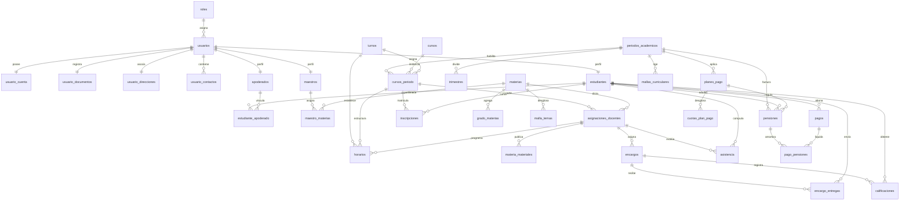
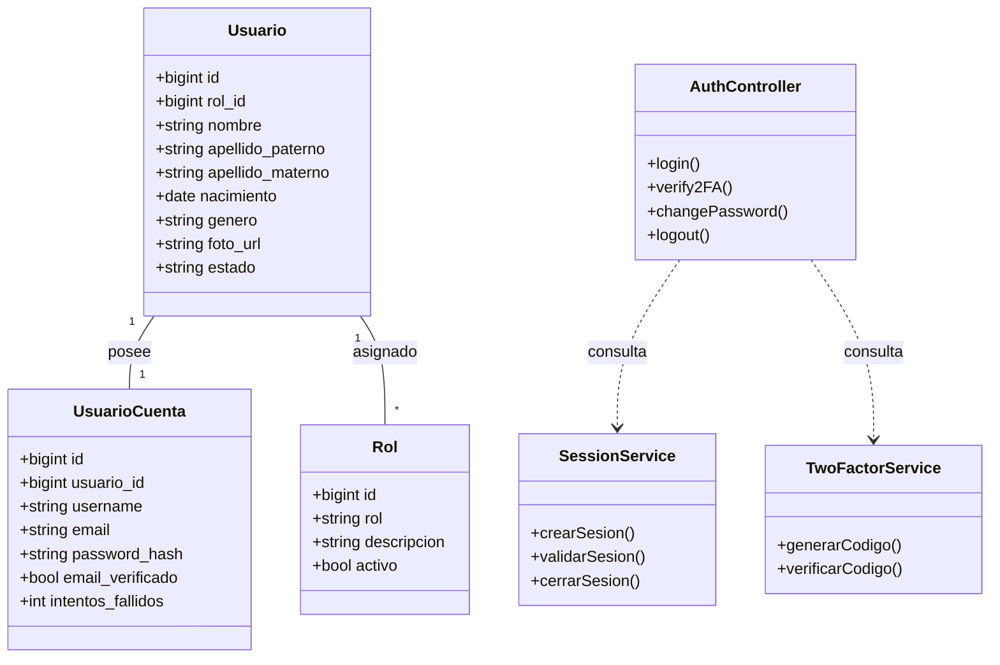
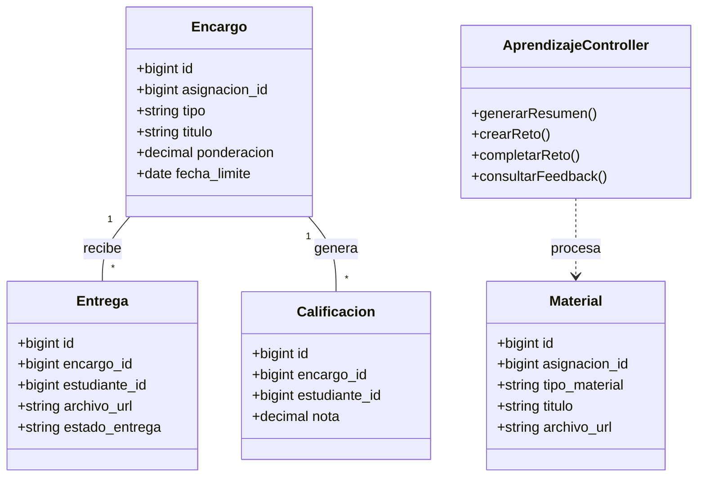
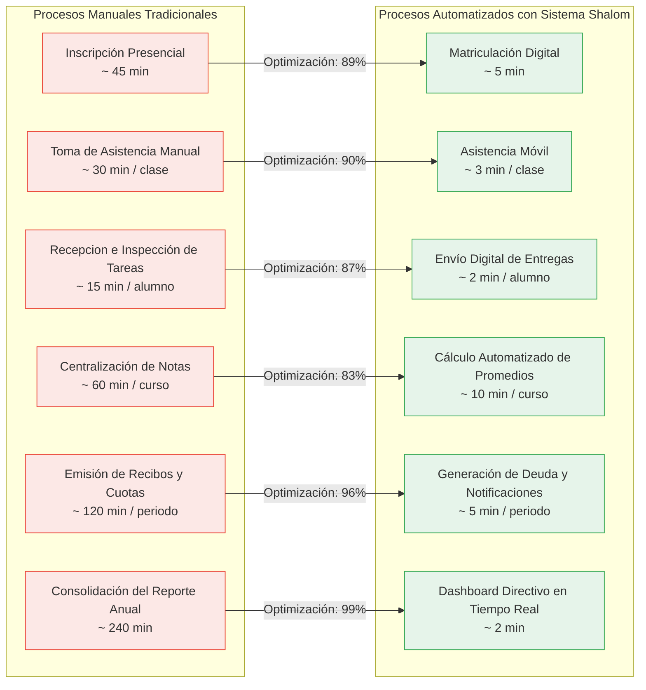

# Sistema de Gestión Académica Shalom

Plataforma integral de gestión académica y aprendizaje asistido desarrollada como proyecto de grado. La solución implementa una arquitectura distribuida compuesta por una **aplicación móvil (Expo / React Native)**, un **Gateway API (ASP.NET Core)**, **nueve microservicios backend (Deno + Oak)** y un **servicio de Inteligencia Artificial (Python + FastAPI + Ollama)**.

La persistencia relacional se administra a través de **PostgreSQL**, con capa de caché e in-memory data store en **Redis**, almacenamiento binario compatible con S3 en **MinIO** y canal bidireccional en tiempo real vía **SignalR**.

---

## 1. Clasificación Tecnológica del Sistema

### 1.1 Lenguajes de Programación
| Lenguaje | Versión | Ámbito de Aplicación |
| :--- | :--- | :--- |
| **TypeScript** | ~6.0.3 | Tipado estático del frontend móvil y lógica de microservicios en Deno. |
| **C#** | 13 (.NET 10) | Desarrollo del API Gateway, canal SignalR y servicios de enrutamiento proxy. |
| **Python** | 3.12 | Motor de IA, procesamiento de documentos y pipeline RAG. |
| **SQL** | ANSI SQL | Definición de esquemas relacionales (`BDmain.sql`, `BDgm.sql`) y semillas de datos. |

### 1.2 Frameworks y Entornos de Ejecución
| Tecnología | Versión | Ámbito de Aplicación |
| :--- | :--- | :--- |
| **React Native** | 0.88.1 | Framework base para el desarrollo de la interfaz de usuario móvil. |
| **React** | 19.3.0 | Librería para renderizado declarativo de componentes UI. |
| **Expo** | ~58.0.21 | Plataforma de desarrollo para abstracción de APIs nativas y emulación. |
| **ASP.NET Core** | .NET 10.0 | API Gateway central para proxy inverso, seguridad y WebSockets. |
| **Deno** | 2.9.7 | Entorno de ejecución seguro para los microservicios backend. |
| **Oak** | ^17.2.0 | Middleware de enrutamiento HTTP para servicios Deno. |
| **FastAPI** | 0.110+ | Framework web asíncrono para el servicio de IA y LLMs. |
| **Uvicorn** | Latest | Servidor ASGI de alto rendimiento para el servicio Python. |
| **Tailwind CSS** | ^3.4.17 | Framework CSS utilitario para la compilación de estilos UI. |

### 1.3 Librerías y Módulos de Soporte
| Componente | Versión | Utilidad Técnica |
| :--- | :--- | :--- |
| **NativeWind** | ^4.2.6 | Adaptador de clases Tailwind CSS para componentes React Native. |
| **React Navigation** | ^7.x | Gestión de pilas de navegación y pestañas en la app móvil. |
| **@db/postgres** | ^0.19.5 | Driver nativo de conexión a PostgreSQL desde Deno. |
| **ioredis** | ^5.4.1 | Cliente Redis con soporte para operaciones Pub/Sub y almacenamiento de sesión. |
| **jose** | ^5.9.6 | Emisión, firma y verificación de tokens de seguridad JWT. |
| **bcryptjs** | ^2.4.3 | Algoritmo de dispersión criptográfica para contraseñas. |
| **sharp** | ^0.34.3 | Procesamiento y optimización de imágenes de perfil. |
| **minio** | ^8.0.2 | SDK para interactuar con el servidor de objetos MinIO S3. |
| **resend** / **@getbrevo/brevo** | Latest | Envíos transaccionales de correo electrónico y 2FA. |
| **PyMuPDF / python-docx** | Latest | Extracción analítica de texto plano desde documentos PDF y Word. |

### 1.4 Infraestructura y Almacenamiento
| Servicio | Versión / Puerto | Descripción Funcional |
| :--- | :--- | :--- |
| **PostgreSQL** | TCP 5432 | Base de datos relacional principal (`ShalomDB` y `ShalomDBGM`). |
| **Redis (Notificaciones)**| TCP 6379 | Eventos Pub/Sub y gestión de sesiones efímeras. |
| **Redis (Vectorial RAG)** | TCP 6380 | Almacenamiento de embeddings para búsquedas semánticas. |
| **MinIO** | TCP 9000 / 9001 | Bucket de objetos para expedientes, comprobantes y tareas. |
| **Ollama Host** | TCP 11434 | Motor de inferencia local para modelos Gemma 3 y Mistral 7B. |
| **ClamAV** | TCP 3310 | Antivirus para desinfección preventiva de adjuntos. |
| **Docker Compose** | Spec v3.8 | Contenerización y orquestación de la red de microservicios. |

> **Nota de Infraestructura:** PostgreSQL, Redis, MinIO, ClamAV y Ollama funcionan como servicios externos al orquestador principal y deben estar previamente desplegados en el host.

---

## 2. Arquitectura del Sistema

El sistema implementa una arquitectura distribuida basada en **Microservicios Desacoplados**, coordinados por un **Gateway Centralizado** que aplica patrones de *Reverse Proxy* y *JWT Offloading*.

```
+─────────────────────────────────────────────────────────────────+
|                      CLIENTE (Mobile App)                       |
|              React Native + TypeScript + NativeWind             |
|                  (Puerto 8081 / Expo Bundler)                   |
+─────────────────────────────────────────────────────────────────+
                               │
                               │ REST /api/*  +  WS SignalR
                               v
+─────────────────────────────────────────────────────────────────+
|                       GATEWAY (RestApi)                         |
|                 ASP.NET Core .NET 10 (Puerto 5141)              |
|            Proxy -> 9 Servicios Deno  +  SignalR Hub            |
+─────────────────────────────────────────────────────────────────+
                               │
      +───────────+───────────+───────────+───────────+───────────+
      v           v           v           v           v           v
+───────+   +─────────+   +─────────+   +──────────+   +─────────+
|User   |   |Academic |   |Enrollment|  | Homework |   |Notific. |
| 8880  |   |  8881   |   |  8882   |   |  8883    |   |  8884   |
+───────+   +─────────+   +─────────+   +──────────+   +─────────+
      │           │           │           │           │
      v           v           v           v           v
+───────+   +─────────+   +─────────+   +──────────+   +─────────+
|Billing|   |Dashboard|   |Gamif.   |   |ControlAc.|   |         |
| 8886  |   |  8885   │   |  8887   |   |  8888    |   |         |
+───────+   +─────────+   +─────────+   +──────────+   +─────────+
      │           │           │           │
      v           v           v           v
+─────────────────────────────────────────────────────────────────+
|                 SERVICIO LLM (ServiceAcademicLLMs)              |
|                Python + FastAPI + Ollama (Puerto 8890)          |
+─────────────────────────────────────────────────────────────────+
                               │
              +────────────────┼────────────────+
              v                v                v
         PostgreSQL       Redis (6379/6380)   MinIO (9000)
         ShalomDB /       Caché + RAG +        Almacenamiento
         ShalomDBGM       Eventos              de Objetos
```

---

## 3. Modelo de Datos Relacional

El modelo se divide en dos bases de datos independientes: `ShalomDB` para la gestión transaccional institucional y `ShalomDBGM` para las métricas de gamificación.

### 3.1 Diagrama Entidad-Relación (ER)



### 3.2 Distribución de Tablas por Microservicio

| Módulo Backend | Tablas Principales | Responsabilidad Operativa |
| :--- | :--- | :--- |
| **ServiceUser** | `roles`, `usuarios`, `usuario_cuenta`, `usuario_documentos`, `usuario_direcciones`, `usuario_contactos`, `estudiantes`, `apoderados`, `maestros` | Autenticación, perfiles, RBAC y datos personales. |
| **ServiceAcademic** | `periodos_academicos`, `trimestres`, `turnos`, `aulas`, `materias`, `cursos`, `grado_materias`, `malla_temas`, `cursos_periodo`, `mallas_curriculares`, `asignaciones_docentes`, `horarios` | Estructura escolar, horarios y mallas de estudio. |
| **ServiceEnrollment** | `solicitudes_inscripcion`, `inscripciones`, `curso_asesor` | Procesos de matriculación y asignación de tutores. |
| **ServiceHomework** | `materia_materiales`, `encargos`, `encargo_materiales`, `encargo_entregas`, `calificaciones` | Recursos didácticos, tareas y notas. |
| **ServiceControlAcademic**| `asistencia`, `examenes`, `reportes_academicos` | Control de asistencia y evaluación cualitativa docente. |
| **ServiceBilling** | `planes_pago`, `cuotas_plan_pago`, `pensiones`, `pagos`, `pago_pensiones` | Cartera, emisión de cuotas y recibos de pago. |
| **ServiceGamification** | `estudiantes_gamificacion`, `rachas_diarias`, `puntos_individuales`, `insignias`, `trofeos`, `tienda_recompensas`, `compras_estudiante` | Motor de incentivos, rachas y tienda virtual. |

---

## 4. Diagramas de Clases por Módulo

### 4.1 Módulo de Autenticación y Seguridad (`ServiceUser`)



### 4.2 Módulo de Tareas y Aprendizaje Inteligente (`ServiceHomework`)



---

## 5. Análisis Comparativo de Eficiencia de Procesos

La implementación del sistema Shalom automatiza la carga operativa tradicional del personal administrativo y docente, reduciendo los tiempos de respuesta de forma considerable:



### 5.1 Tabla Resumen de Tiempos Operativos

| Flujo Académico / Administrativo | Tiempo Operativo Previo | Tiempo Operativo Shalom | Porcentaje de Reducción |
| :--- | :--- | :--- | :--- |
| **Inscripción de Estudiante** | 45 minutos | 5 minutos | **88.8 %** |
| **Control de Asistencia por Aula** | 30 minutos | 3 minutos | **90.0 %** |
| **Entrega y Verificación de Tareas** | 15 minutos | 2 minutos | **86.6 %** |
| **Cierre de Trimestre y Promedios** | 60 minutos | 10 minutos | **83.3 %** |
| **Generación de Plan de Colegiaturas** | 120 minutos | 5 minutos | **95.8 %** |
| **Consolidación de Indicadores (KPIs)** | 240 minutos | 2 minutos | **99.1 %** |

---

## 6. Mapeo de Puertos y Servicios

| Identificador | Servicio | Puerto Interno / Host | Protocolo / Propósito |
| :--- | :--- | :--- | :--- |
| `srv-user` | ServiceUser | TCP 8880 | REST / WebSockets (Gestión de usuarios y tokens). |
| `srv-academic` | ServiceAcademic | TCP 8881 | REST (Malla curricular, materias y horarios). |
| `srv-enrollment`| ServiceEnrollment | TCP 8882 | REST (Inscripciones y asignaciones de curso). |
| `srv-homework` | ServiceHomework | TCP 8883 | REST (Calificaciones, tareas y carga de materiales). |
| `srv-notif` | ServiceNotification | TCP 8884 | REST / PubSub (Gestión de eventos y notificaciones). |
| `srv-dash` | ServiceDashboard | TCP 8885 | REST (Analítica institucional y reportes en frío). |
| `srv-billing` | ServiceBilling | TCP 8886 | REST (Planes de pago, deudas y cobranza). |
| `srv-gamif` | ServiceGamification | TCP 8887 | REST (Motor de rachas, puntos e insignias). |
| `srv-control` | ServiceControlAcademic | TCP 8888 | REST (Cuaderno docente, asistencias y exámenes). |
| `gateway` | RestApi Gateway | TCP 5141 / 7064 | REST / SignalR Hub (Proxy reverso principal). |
| `srv-llm` | ServiceAcademicLLMs | TCP 8890 | REST (Pipelines RAG, resúmenes y tutoría IA). |
| `minio` | MinIO Storage | TCP 9000 / 9001 | S3 API / Consola de administración. |
| `redis-notif` | Redis Eventos | TCP 6379 | In-memory Data Structure Store (Pub/Sub). |
| `redis-rag` | Redis Vectorial | TCP 6380 | Vector Database (Búsqueda por similitud coseno). |
| `ollama` | Ollama Host | TCP 11434 | HTTP API (Modelos Gemma 3 y Mistral 7B). |
| `clamav` | ClamAV Daemon | TCP 3310 | Socket TCP de inspección de firmas maliciosas. |

---

## 7. Estructura Directoria del Proyecto

```text
Sistema/
├── README.md                     # Documentación principal del proyecto
├── AGENTS.md                     # Directrices para agentes de IA
├── docker-compose.yml           # Orquestación de contenedores Docker
├── .env                          # Configuración global de variables de entorno
├── Esquems/                      # Scripts de base de datos relacional
│   ├── BDmain.sql                # Esquema principal (ShalomDB)
│   ├── BDgm.sql                  # Esquema de gamificación (ShalomDBGM)
│   ├── datos.sql                # Semillas de inicialización
│   └── reiniciar.sql            # Script de saneamiento y reseteo
├── Frontend/                     # Cliente móvil en React Native y Expo
├── RestApi/                      # Gateway API en ASP.NET Core (.NET 10)
├── ServiceUser/                  # Microservicio de usuarios (Deno)
├── ServiceAcademic/              # Microservicio académico (Deno)
├── ServiceEnrollment/            # Microservicio de matriculación (Deno)
├── ServiceHomework/              # Microservicio de tareas y evaluaciones (Deno)
├── ServiceNotification/          # Microservicio de notificaciones (Deno)
├── ServiceDashboard/             # Microservicio de analítica directiva (Deno)
├── ServiceBilling/               # Microservicio financiero (Deno)
├── ServiceGamification/          # Microservicio de gamificación (Deno)
├── ServiceControlAcademic/       # Microservicio de control escolar (Deno)
└── ServiceAcademicLLMs/          # Servicio de IA y modelos LLM (Python)
```

---

## 8. Comandos de Despliegue y Validación

### 8.1 Despliegue con Docker Compose
```bash
# Inicializar la totalidad de los microservicios en segundo plano
docker compose -p shalom_backend --env-file .env up -d

# Consultar el estado operativo de los contenedores
docker compose -p shalom_backend ps
```

### 8.2 Ejecución Individual de Servicios en Modo Desarrollo
```bash
# Microservicios Backend en Deno
cd ServiceUser
deno task dev

# Gateway ASP.NET Core
dotnet run --project RestApi/RestApi.csproj

# Servicio de Inteligencia Artificial (Python)
cd ServiceAcademicLLMs
python3 -m uvicorn app.main:app --port 8890 --reload

# Cliente Móvil Expo
cd Frontend
npx expo start
```

### 8.3 Verificación de Tipos y Compilación
```bash
# Chequeo estático en microservicios Deno
deno check ServiceUser/server.ts

# Verificación de tipos en Frontend React Native
cd Frontend && npx tsc --noEmit

# Compilación de verificación en Gateway .NET
dotnet build RestApi/RestApi.csproj
```
